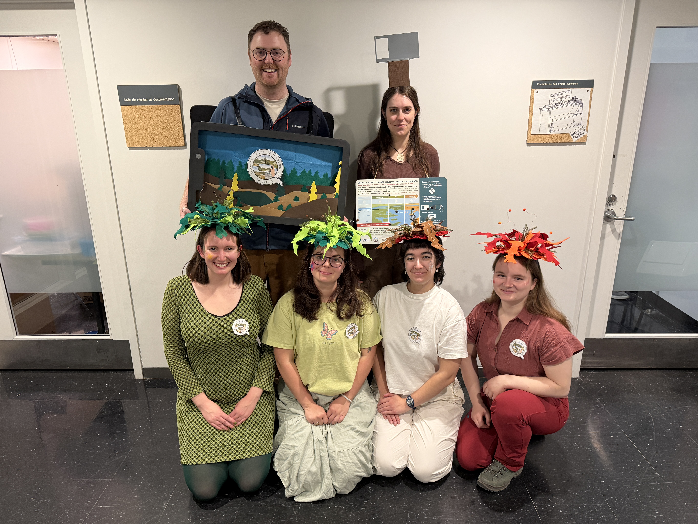
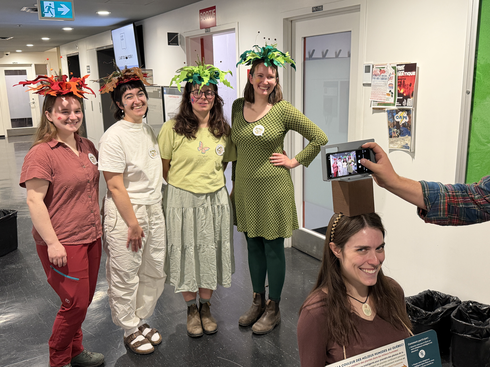
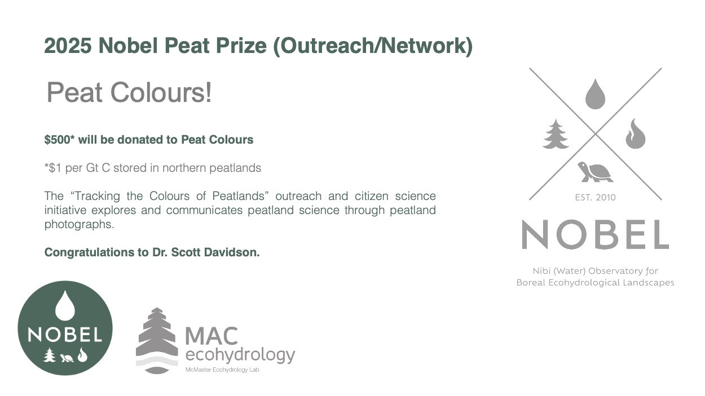

*October 2026*

We decided to bring PeatColours to life this Halloween with costumes inspired by the project! 🎃

::: {.columns}
::: {.column width="50%"}
{fig-alt="PeatColours Halloween costumes" width="100%"}
:::

::: {.column width="50%"}
{fig-alt="The team dressed as the PeatColours project" width="100%"}
:::
:::

*January 2026*

I gave a presentation for the Wetland Exchange Network's seminar series titled **Exploring Peatland Phenology: Tracking the Colour of Peatlands using Community Science**. You can watch it by clicking the image below:

::: {.text-center}
[{width=720}](https://vimeo.com/1157257231)
:::

*December 2025*

The **Tracking the Colour of Peatlands** project won the 2025 *Nobel Peat Prize for Best Outreach/Network*

{fig-align="center"}

*October 2025*

I wrote this article with Avni Malhotra (PNNL/University of Zurich) for The Conversation as part of the PeatColours project, which uses technology and global collaboration to improve understanding of peatlands.

<a href="https://theconversation.com/harnessing-technology-and-global-collaboration-to-understand-peatlands-265472" target="_blank" rel="noopener">
  Harnessing technology and global collaboration to understand peatlands
</a>
