

Ce projet est réalisé dans le cadre de la <strong>Chaire de recherche CARCLIQUE</strong>, financée par le gouvernement du Québec dans le cadre du <em>Plan pour une économie verte 2030</em>.

<a href="https://carclique.uqam.ca/" target="_blank">
En savoir plus sur la Chaire CARCLIQUE
</a>

À chaque visite d'un site, prenez une photo du milieu humide à partir d'un point de vue fixe à l'aide de l'un de nos supports pour téléphone spécialement conçus, puis envoyez-nous votre photo. Ensemble, nous pourrons suivre l'évolution de la couleur des milieux humides tout au long de l'année.

  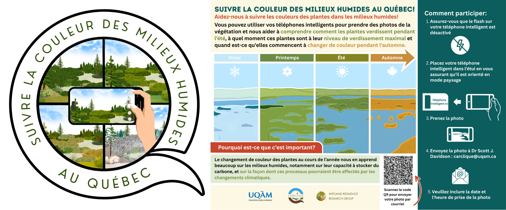

## Voyage à travers les milieux humides du Québec

Découvrez les paysages, les équipes de terrain et les milieux humides qui rendent ce projet possible. Ces images offrent un aperçu du travail réalisé partout au Québec pour suivre les changements de couleur des milieux humides au fil des saisons.

<button class="carousel-button prev" type="button" aria-label="Image précédente">&#10094;</button>

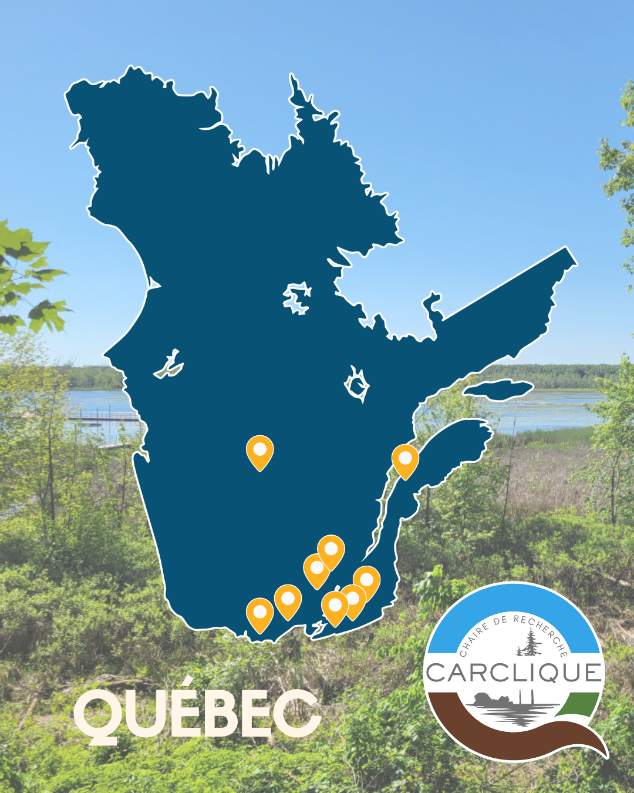

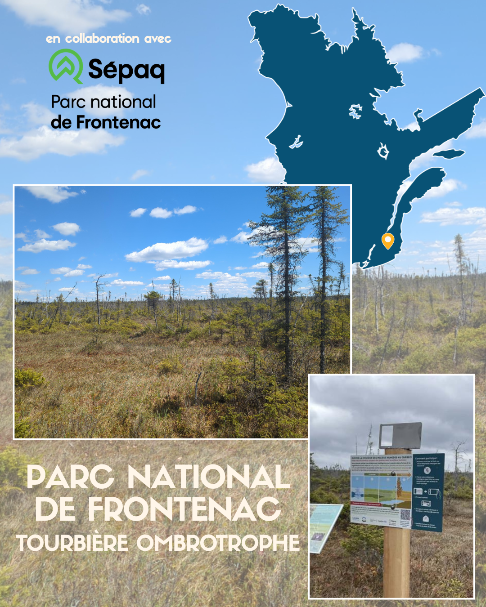

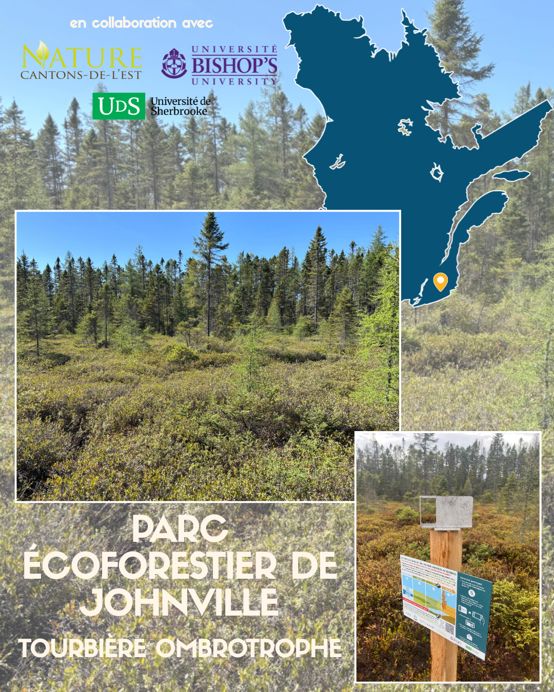

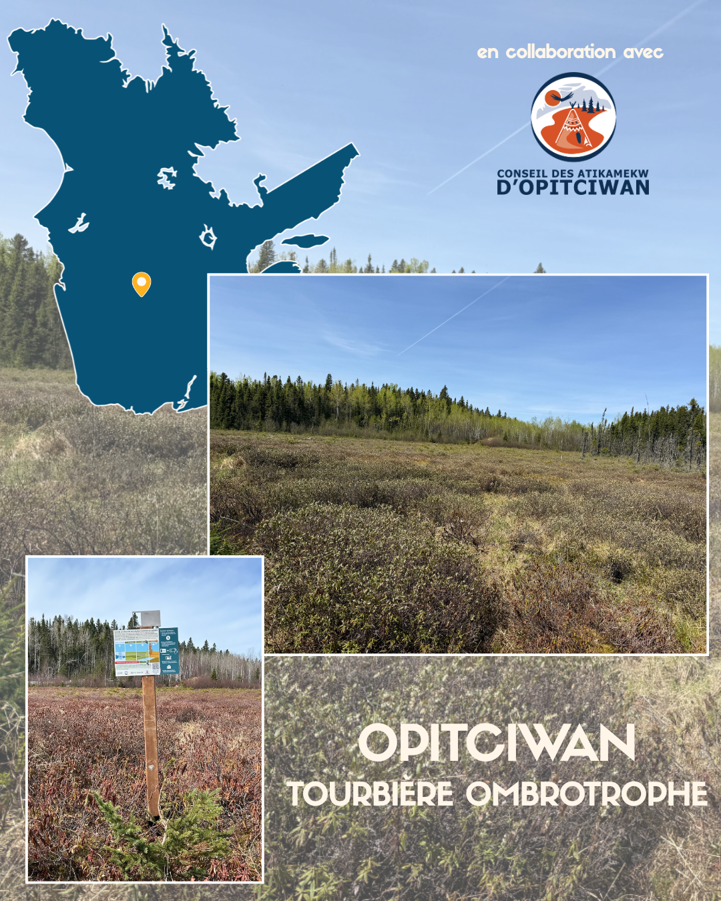

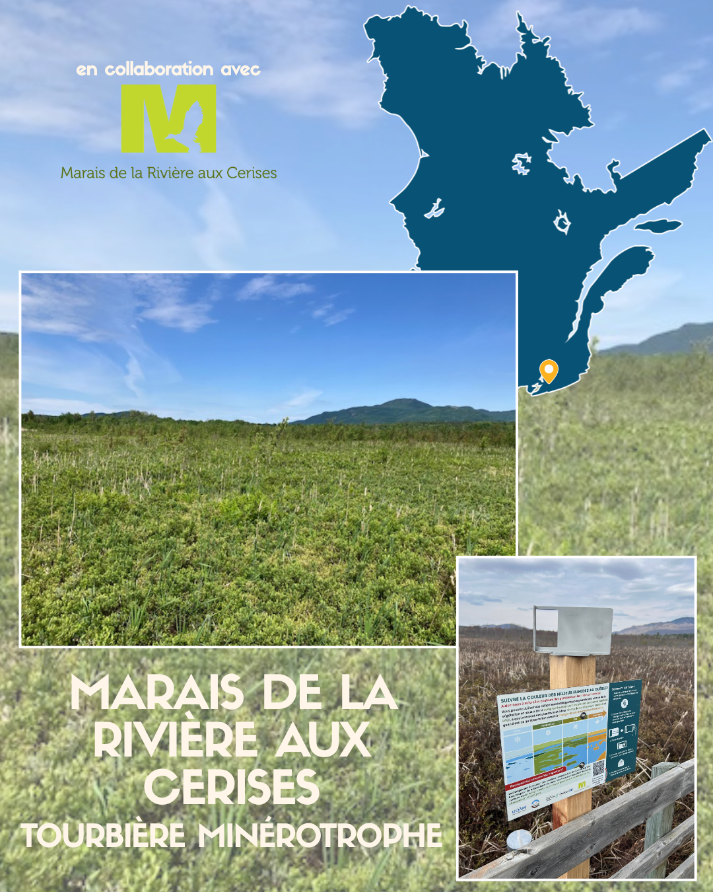

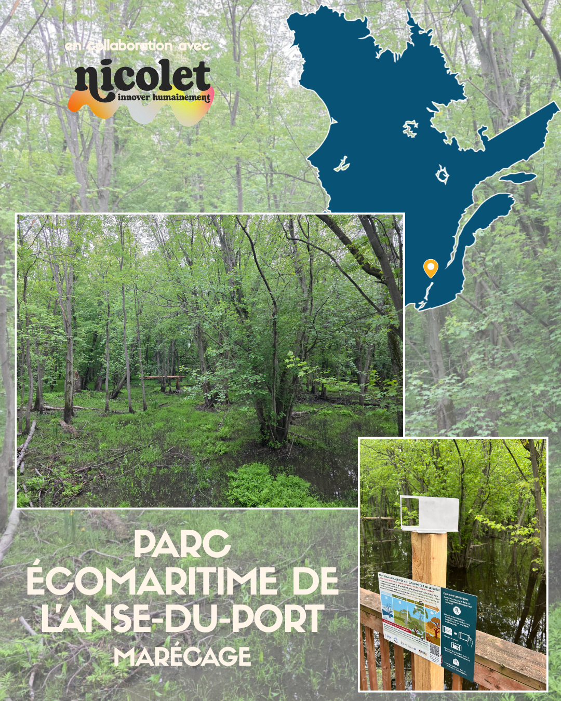

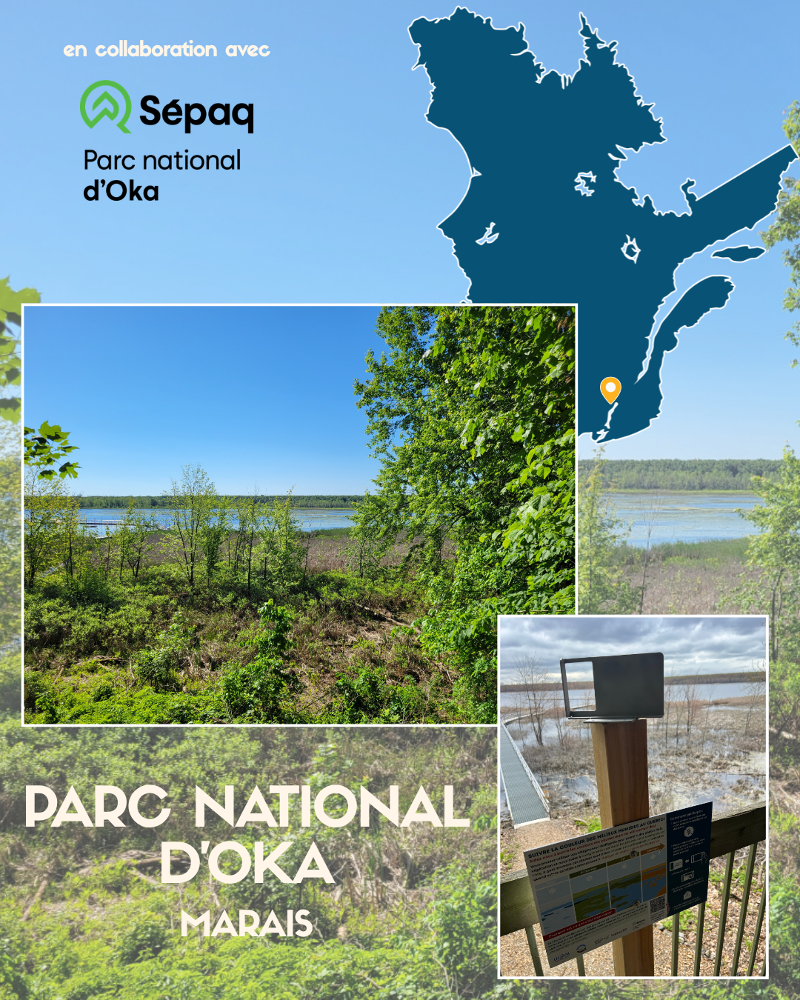

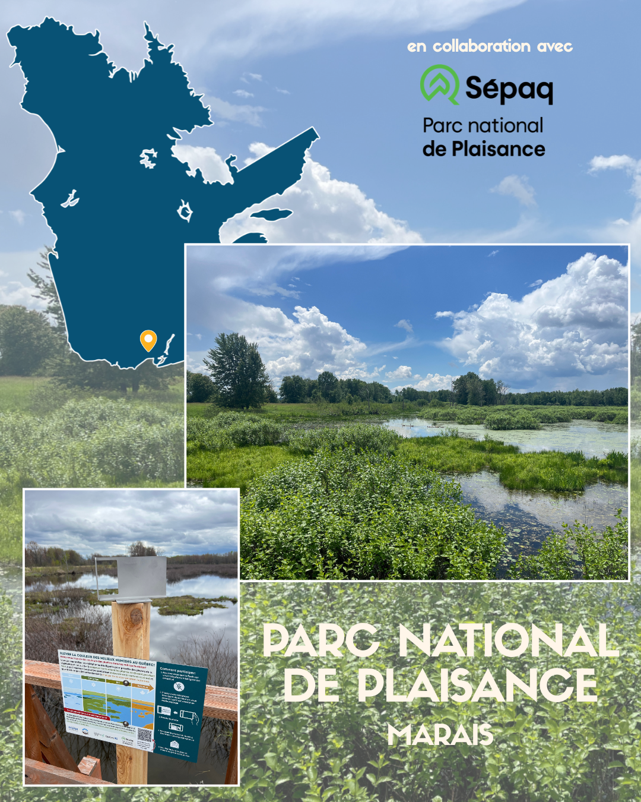

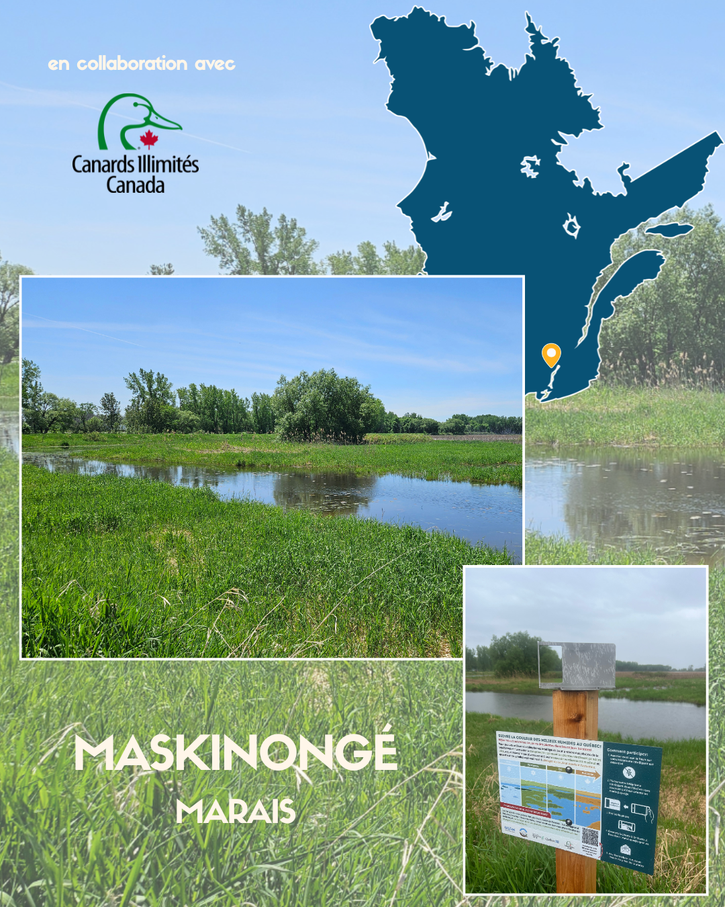

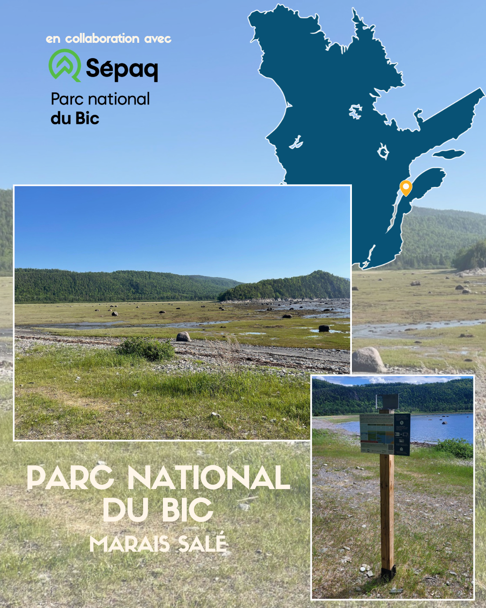

<button class="carousel-button next" type="button" aria-label="Image suivante">&#10095;</button>

1 / 10

<a
  href="https://www.instagram.com/peatcolours/"
  target="_blank"
  rel="noopener noreferrer"
  aria-label="Suivre Peat Colours sur Instagram">

<svg
  class="instagram-logo"
  viewBox="0 0 24 24"
  width="28"
  height="28"
  aria-hidden="true"
  focusable="false">
  <rect x="2.5" y="2.5" width="19" height="19" rx="5.5" fill="none" stroke="currentColor" stroke-width="2"></rect>
  <circle cx="12" cy="12" r="4.25" fill="none" stroke="currentColor" stroke-width="2"></circle>
  <circle cx="17.5" cy="6.5" r="1.2" fill="currentColor"></circle>
</svg>
Suivez le projet sur Instagram : @peatcolours

</a>

  <iframe 
    src="https://peatcolours.shinyapps.io/quebec-map-app/" 
    title="Sites de milieux humides au Québec"
    scrolling="no"
    frameborder="0"
    style="border: 0; width: 100%; height: 100%;">
    
Your browser does not support iframes.

  </iframe>

## Détails du site

### Québec

<strong>Parc national de Frontenac</strong>

**Emplacement** : Québec, Canada 
**Type de milieux humide** : tourbière ombrotrophe 
**Coordonnées** : 45.969667, -71.150944 
<strong>Partenaires du projet de recherche</strong> : Sepaq

🌐 [Informations sur le site](https://www.sepaq.com/pq/fro/)  
🗺 [Voir sur la carte](https://maps.app.goo.gl/u5isSxunr8LKn4iLA)

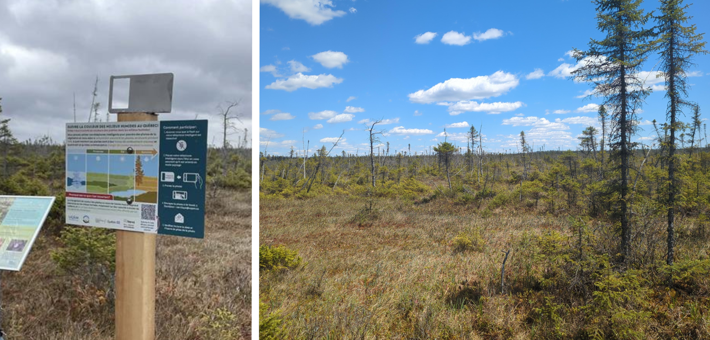

<strong>Parc écoforestier de Johnville</strong>

**Emplacement** : Québec, Canada 
**Type de milieux humide** : tourbière ombrotrophe 
**Coordonnées** : 45.346917, -71.738167 
<strong>Partenaires du projet de recherche</strong> : Université de Sherbrooke, Université Bishop's, Nature Cantons-de-l'Est

🌐 [Informations sur le site](https://naturecantonsdelest.ca/nce/johnville-park/)  
🗺 [Voir sur la carte](https://maps.app.goo.gl/STnKgYjNFTbAm6aL6)

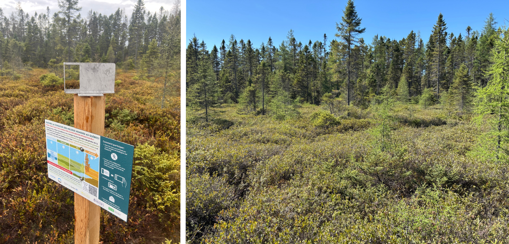

<strong>Opitciwan</strong>

**Emplacement** : Québec, Canada 
**Type de milieux humide** : tourbière ombrotrophe 
**Coordonnées** : 48.663417, -74.944167 
<strong>Partenaires du projet de recherche</strong> : Conseil des Atikamekw D’Opitciwan

🗺 [Voir sur la carte](https://maps.app.goo.gl/QfaWHb5kGM8f26mBA)

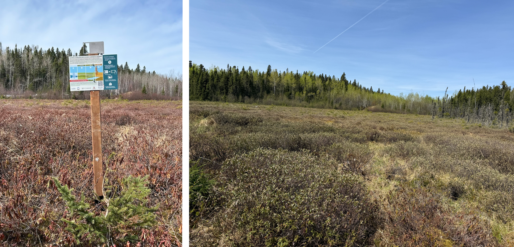

<strong>Marais de la Rivière aux Cerises</strong>

**Emplacement** : Québec, Canada 
**Type de milieux humide** : tourbière minérotrophe 
**Coordonnées** : 45.275972, -72.165611 
<strong>Partenaires du projet de recherche</strong> : Marais de la Rivière aux Cerises

🌐 [Informations sur le site](https://maraisauxcerises.com/)  
🗺 [Voir sur la carte](https://maps.app.goo.gl/w8Wq5Xd6CghLZHTp6)

<strong>Parc national d'Oka</strong>

**Emplacement** : Québec, Canada 
**Type de milieux humide** : marais 
**Coordonnées** : 45.487472, -74.007417 
<strong>Partenaires du projet de recherche</strong> : Sepaq

🌐 [Informations sur le site](https://www.sepaq.com/pq/oka/)  
🗺 [Voir sur la carte](https://maps.app.goo.gl/J6PZh5wc6zL8MH329)

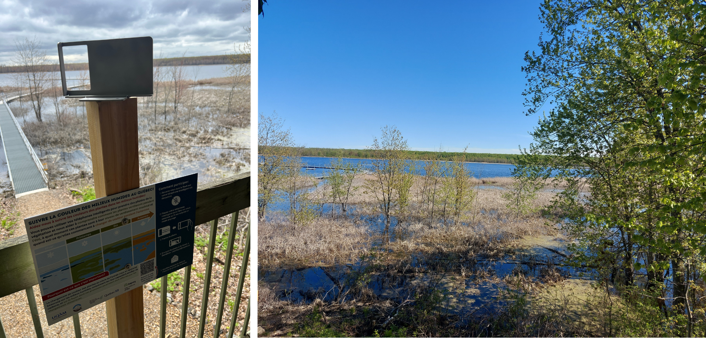

<strong>Parc national du Plaisance</strong>

**Emplacement** : Québec, Canada 
**Type de milieux humide** : marais 
**Coordonnées** : 45.594778, -75.086722 
<strong>Partenaires du projet de recherche</strong> : Sepaq

🌐 [Informations sur le site](https://www.sepaq.com/pq/pla/)  
🗺 [Voir sur la carte](https://maps.app.goo.gl/Rfxnxs6BfpddvvnK7)

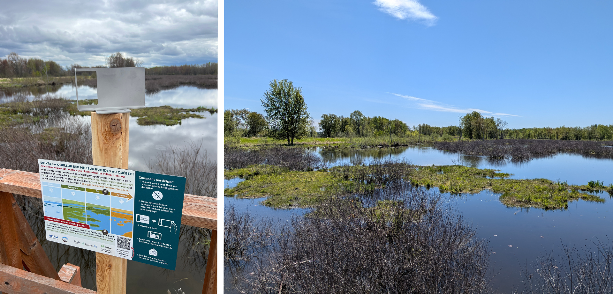

<strong>Maskinongé</strong>

**Emplacement** : Québec, Canada 
**Type de milieux humide** : marais 
**Coordonnées** : 46.180212, -73.038257 
<strong>Partenaires du projet de recherche</strong> : Canard Illimités Canada

🌐 [Informations sur le site](https://www.canards.ca/des-nouvelles/provincial-fr/quebec-fr/lequipe-du-quebec-de-canards-illimites-canada-inaugure-son-premier-sentier-pedestre-a-maskinonge-dans-la-region-du-lac-saint-pierre-reputee-pour-sa-biodiversite-exceptionnelle/)  
🗺 [Voir sur la carte](https://maps.app.goo.gl/Rfxnxs6BfpddvvnK7)

<strong>Parc Écomaritime de l'Anse-du-Port</strong>

**Emplacement** : Québec, Canada 
**Type de milieux humide** : marécage 
**Coordonnées** : 46.253427, -72.640365 
<strong>Partenaires du projet de recherche</strong> : Nicolet

🌐 [Informations sur le site](https://nicolet.ca/fr/repertoire/1666/parc-ecomaritime-de-l-anse-du-port)  
🗺 [Voir sur la carte](https://maps.app.goo.gl/UDU8u3rwsWYr79Sp8)

<strong>Parc national du Bic</strong>

**Emplacement** : Québec, Canada 
**Type de milieux humide** : marais salé 
**Coordonnées** : -68.779567, 48.3599747 
<strong>Partenaires du projet de recherche</strong> : Sepaq

🌐 [Informations sur le site](https://www.sepaq.com/pq/bic/)  
🗺 [Voir sur la carte](https://maps.app.goo.gl/jfe31m1jnXthTMna8)

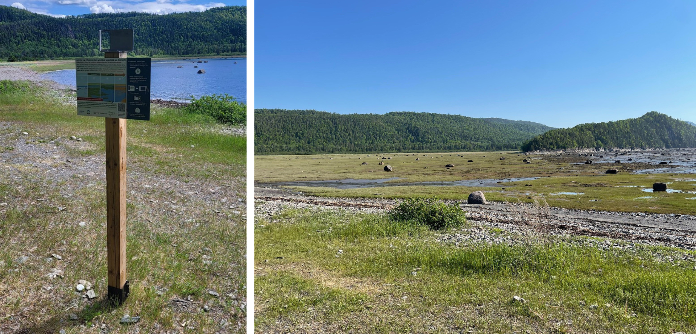

